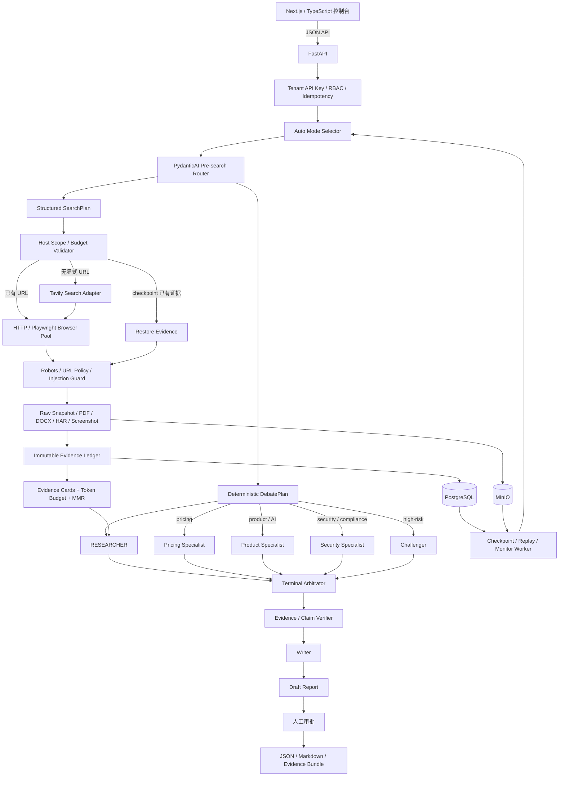

# Competitor Intelligence Agent

Competitor Intelligence Agent 是一个面向产品、价格、能力、安全与市场变化研究的生产化多智能体系统，基于 PydanticAI 2.x、官方 `pydantic-ai-harness` 和 `pydantic-evals` 构建。系统将自动模式选择、网页采集、不可变证据账本、上下文压缩、受约束辩论、断点恢复、持续监控、人工审批和研究质量评测组合在同一条业务链路中。

项目强调“证据先于结论”：每个 Claim 必须引用当前 tenant、当前运行中的 Evidence；数字、价格、日期和战略判断不能绕过证据契约直接进入报告。完整设计与当前实现边界分别见 [完整落地项目规划.md](./完整落地项目规划.md) 和 [IMPLEMENTATION_STATUS.md](./IMPLEMENTATION_STATUS.md)。

## 技术栈

| 层 | 技术 | 用途 |
|---|---|---|
| 运行时与 API | Python 3.12、Pydantic v2、FastAPI、Uvicorn | 类型安全的业务模型、HTTP API 和服务进程 |
| Agent 编排 | PydanticAI 2.33.0、`pydantic-ai-harness` 0.24.0、`pydantic-evals` 2.33.0 | Router、领域专家、Challenger/Arbitrator、Harness 工作流与评测接口 |
| 模型与搜索 | 兼容 OpenAI 协议的模型服务、Tavily、`openai` SDK | 研究、综合、Judge 和网页检索；模型通过环境变量切换 |
| 浏览与文档处理 | Playwright、HTTPX、BeautifulSoup、Markdownify、pypdf、python-docx、robots parser | 动态网页、PDF/DOCX、正文抽取、robots 与注入防护 |
| 数据与持久化 | SQLAlchemy 2、PostgreSQL、MinIO/S3、`boto3` | tenant-scoped 运行状态、checkpoint、证据账本和原始 artifact |
| 可靠性与观测 | Tenacity、Prometheus client、OpenTelemetry OTLP、Jaeger、Grafana | 分层重试、预算指标、分布式 trace、监控面板与告警 |
| 前端控制台 | Next.js 15、React 19、TypeScript 5.8、Zod 4 | 研究请求、运行状态、审批和报告导出界面 |
| 工程工具 | `uv`、pytest、PowerShell | 依赖/打包、确定性测试和 Windows 原生服务脚本 |

PostgreSQL、MinIO、Jaeger、Prometheus 和 Grafana 是可独立部署的基础服务；Windows 开发环境可以使用项目脚本连接本机服务，生产环境再替换为托管实例。密钥只通过 `.env` 或部署平台 Secret 注入，仓库仅提交 `.env.example`。

## 系统架构



## 核心能力

- 根据输入自动选择 `investigation`、`monitor` 或 `verify`，并独立校验 Router 的任务类型是否与模式兼容。
- Router 在任何外部搜索前一次性返回结构化 `RouterDecision`：`ResearchRoute` 决定任务类型、维度和风险，`SearchPlan` 按 `pricing`、`product`、`security` 为目标竞品生成独立查询；宿主校验竞品/维度覆盖、重复查询、搜索次数和页面预算后才允许执行。
- 搜索不是 Agent 自主执行的工具调用。Router 只生成计划，`ResearchOrchestrator` 根据显式 URL、checkpoint 和预算决定是否执行，再由 `TavilySearch` 和 `BrowserCollector` 完成搜索与抓取。Researcher 只接收经过 robots/URL 策略、提示词注入隔离、证据账本和 EvidenceCard 压缩后的内容，因此外部网页不能改变 Agent 流程或产生副作用。
- 宿主层根据 `ResearchRoute` 生成受预算约束的 `DebatePlan`：按维度激活 0-2 个领域专家，高风险时增加 Challenger；所有路径都经过终端 Arbitrator，LLM 失败时进入确定性的 ArbitratorLite。
- Pydantic 模型约束 Router、Evidence、Claim、Finding、Report、预算和 trace，不依赖自由文本约定关键业务合同。
- PydanticAI Harness 提供 DynamicWorkflow、Planning、StepPersistence 和工具输出限制；宿主层继续负责 tenant、安全、浏览、预算和发布边界。
- PostgreSQL checkpoint 与运行租约支持三种模式中断后继续，避免两个 worker 同时恢复同一运行。
- monitor worker 使用数据库任务锁、过期锁恢复、失败重试、指数退避和多租户调度执行持续监控。
- 成功运行可生成 tenant-scoped Research Playbook candidate；候选必须通过 replay 门禁并由 approver/admin 晋级，不会自动覆盖生产版本。
- 报告发布前必须审批；API key 支持哈希存储、到期、撤销、轮换和宽限期，审计载荷执行敏感信息脱敏。

## 输入、模式与输出

研究输入由 `brief`、`competitors`、可选 `urls` 和默认值为 `auto` 的 `mode` 组成。

| 模式 | 适用输入 | 执行语义 |
|---|---|---|
| `investigation` | 一次性比较、市场或能力研究 | 采集当前证据并生成新的研究报告 |
| `monitor` | 持续跟踪价格、功能、政策或安全变化 | 定时重新抓取，绕过页面缓存，以历史知识为变化基线 |
| `verify` | 核实指定数字、日期、价格或事实 | 收窄研究范围，明确返回支持、冲突与未知项 |

执行顺序固定为 `Router -> SearchPlan 校验与采集 -> Researcher -> 0..2 个领域专家 -> 可选 Challenger -> Arbitrator -> Writer`。领域专家由宿主的确定性 `DebatePlan` 选择，而不是直接信任模型返回的调用数量：价格维度使用 `pricing`，AI/产品/集成使用 `product`，安全/合规使用 `security`。企业或高风险任务会限制为一个领域专家并增加 Challenger，以保持最多四次预裁决 Agent 调用；低风险任务可以没有领域专家，但仍经过 Arbitrator 终端门。

`mode=auto` 先由 [mode.py](./src/ci_agent/mode.py) 识别显式模式和监控/验证信号，再由 PydanticAI Router 细化 `task_kind`、复杂度和维度，最后用 [route_policy.py](./src/ci_agent/route_policy.py) 生成可执行计划。Router 的 `required_agents` 只是建议，不能绕过宿主预算、安全和证据边界。

输出不是单段回答，而是一个可审计 artifact：结构化报告、Verified Findings、Claims、Evidence UUID、未知项、建议、执行 trace、原始快照引用和审批状态。API 支持 JSON、Markdown 和包含证据的 ZIP bundle 导出。

同一个 `Idempotency-Key` 重新提交会从 PostgreSQL checkpoint 恢复；新问题使用新 key，不会续写旧报告。同一 tenant 下的新研究可以按竞品名称和 TTL 复用已验证知识，但仍会建立新的运行和证据范围。被 prompt-injection 隔离的页面不会进入上下文、checkpoint 知识或最终知识库。

## 证据与上下文 Harness

浏览内容一律按不可信数据处理。采集层执行域名策略、私网地址阻断、robots 检查、单域名限速、TTL 缓存、并发限制和 prompt-injection 检测，并可留存原始页面、清洗文本、PDF/DOCX 正文、截图与 Playwright HAR。MinIO 保存大对象，PostgreSQL 保存 tenant-scoped 元数据和业务状态，本地对象目录作为可恢复后备。

上下文采用分层收敛，而不是把网页全文交给 Writer：

```text
Raw snapshot
  -> Evidence + EvidenceCard
    -> ResearchBundle + verified claims
      -> VerifiedFinding
        -> final report
```

EvidenceCard 通过 brief 相关度、来源可信度、MMR 去重和同源惩罚选择内容，并限制总 token、卡片数和单卡 token。Writer 只读取已验证 Finding 与 ID，不能直接从原始网页补写事实。

## 记忆、恢复与 Playbook 演化

系统当前区分四类可复用状态：运行内 EvidenceCard 上下文、PostgreSQL checkpoint、tenant-scoped 已验证竞品知识，以及 monitor 的历史变化基线。原始证据和 replay 对象由 MinIO 与本地对象目录保存；恢复时同时校验数据库归属和对象前缀，不能跨 tenant 读取。

Research Playbook 是受控的程序性记忆层。成功运行被固化为 replay，并可生成研究维度、查询模板、触发条件或 Writer 指导的候选版本。候选至少需要 2 条通过证据与运行合同的 replay 且没有硬失败，之后仍需 approver/admin 显式晋级。Playbook 无权修改 Evidence/Claim schema、权限、浏览安全、预算、审批和发布规则。

## 模型与基础服务


| 用途 | 当前默认模型或服务 |
|---|---|
| 快速路由 | `gemini-2.5-flash` |
| Researcher / pricing / product / security / Challenger | `deepseek-v4-flash` |
| Writer / Arbitrator | `deepseek-v4-flash` |
| 评测 Judge | `claude-sonnet-5` |
| 网页搜索 | Tavily |
| 业务状态、checkpoint、锁与审计 | PostgreSQL 16 |
| 原始证据、截图、HAR 与 replay 对象 | MinIO |
| Trace | OpenTelemetry + Jaeger |
| Metrics 与 dashboard | Prometheus + Grafana |

传输重试、模型 fallback、工具重试和结构化输出修复分别受限，避免嵌套重试造成请求倍增。每次运行还设置搜索数、页面数、模型请求、Agent 调用、费用、并发和总时间预算。

## 评测方法与位置

项目把“能否安全、完整地运行”和“研究内容质量”分开评测，不把它们压成一个总分。评测结果是运行时生成的 artifact，不在 README 中固化某次模型运行的分数。

### 测试数据

- `benchmarks/ci_bench/`：离线、不可变的工程合同集。用于验证 schema、证据账本、路由边界、预算、重试、恢复、缓存、注入隔离、tenant 权限和导出等系统行为；它包含合成竞品，不用于代表真实市场研究质量。
- `benchmarks/ci_real/`：真实产品和公开网页证据集。产品目录参考 ComparEdge 的固定提交，AI、价格和安全证据来自官方页面；用于最终研究质量评测。构建脚本会通过 Browser Harness 留存原始快照、清洗文本、来源元数据和 hash。

两套数据都只有 `test` 用途，没有 train/dev，不用于训练、Prompt 调参或模型选择。生成和校验入口分别是 `benchmarks/ci_bench/generate_ci_bench.py`、`benchmarks/ci_bench/validate_ci_bench.py` 和 `benchmarks/ci_real/build_ci_real.py`。

### 五维 LLM Judge

研究质量使用 `pydantic-evals` 的五个独立 `LLMJudge`，通过兼容 OpenAI 协议的 provider 调用配置的 Judge 模型（默认 `claude-sonnet-5`）：

- `citation_entailment`：逐条检查 Claim、Finding 和最终陈述是否被引用摘录真正蕴含，识别套餐归属错误、竞品串引、过度改写和伪造链接。
- `citation_completeness`：检查数字、价格、日期、功能、认证、套餐判断、矛盾和战略判断是否都有相关 Claim 与证据。
- `source_quality`：检查官方来源优先级、来源类型、发布者匹配、时效性、scope 和二手来源使用。
- `analysis_quality`：检查两个竞品和请求维度的覆盖、事实与推断区分、矛盾/未知处理及推理链条。
- `business_usefulness`：检查企业决策差异、影响、风险、未知项和下一步是否具体且有证据依据。

Judge 只读取任务、Evidence、Finding 和 Claims；完整 trace、上下文卡和执行诊断不会作为研究内容依据。每个维度独立返回连续分数和理由，供应商错误或缺失结果不会被当作通过。

实现位置：

- `scripts/run_research_eval_subset.py`：调用真实 Router、Researcher、领域专家、Challenger、Arbitrator 和 Writer，保存 JSONL 输出及 trace。
- `scripts/score_research_quality.py`：建立五个 `pydantic-evals` Judge、执行重试、生成逐案理由和维度聚合结果。
- `tests/`：确定性证据契约、模式识别、动态 DebatePlan 和安全边界测试。
- `data/`：运行产生的 JSONL、Judge 报告和 replay artifact；文件名只表示运行输入，不代表固定质量结论。

示例命令：

```powershell
$env:PYTHONPATH = "src"
python .\scripts\run_research_eval_subset.py --cases benchmarks/ci_real/cases.jsonl --all --output data/ci-real-agent-output.jsonl
python .\scripts\score_research_quality.py --input data/ci-real-agent-output.jsonl --output data/ci-real-quality.json --judge-model claude-sonnet-5
```

评测前应冻结代码、模型 ID、Prompt、工具、证据快照、预算和 rubric；改变这些要素后必须生成新的输出文件，不能把旧结果当作新版本结论。

## 项目结构

- `src/ci_agent/orchestrator.py`：模式、预算、恢复、路由、辩论、验证和报告主链路。
- `src/ci_agent/route_policy.py`：根据模式、维度和风险生成受预算约束的 DebatePlan。
- `src/ci_agent/models.py`：Evidence、Claim、Finding、Report、预算与 trace schema。
- `src/ci_agent/browser.py`：URL 安全、robots、缓存、HTTP/Playwright、PDF/DOCX 和录制。
- `src/ci_agent/context.py`：EvidenceCard 构建、token 预算和 MMR 压缩。
- `src/ci_agent/persistence.py`：PostgreSQL 业务持久化、checkpoint、monitor 锁与 tenant 查询。
- `src/ci_agent/object_store.py`：MinIO 与本地 artifact 存储。
- `src/ci_agent/replay.py`：PostgreSQL + MinIO replay，以及 JSON/Markdown/ZIP 导出。
- `src/ci_agent/playbook.py`：候选、replay 门禁和 tenant-scoped Playbook 晋级。
- `src/ci_agent/api.py`：FastAPI、认证、审批、导出、monitor 和 Playbook API。
- `frontend/`：Next.js 15、React 19、TypeScript 研究控制台。
- `benchmarks/ci_bench/`：100 条 test-only CI-Bench 定义与校验器。
- `benchmarks/ci_real/`：真实产品、官方证据快照、CI-Real30 case 和 manifest。
- `scripts/`：服务启动、monitor worker、smoke test 和评测 runner。
- `ops/`：Prometheus 配置、告警规则和 Grafana dashboard。

## Windows 启动

需要 Windows 10/11、Python 3.12+、Node.js 18+ 和 Playwright Chromium。项目支持 Windows 原生 PostgreSQL、MinIO 和 Jaeger；`docker-compose.yml` 提供可选的容器化基础设施与 Prometheus/Grafana。

```powershell
cd D:\yan\learn\pydanticai-competitor-intelligence-agent
python -m pip install -e .
python -m playwright install chromium
Copy-Item .env.example .env
```

在 `.env` 中设置模型服务 API key、`TAVILY_API_KEY` 和用于初始管理员的 `SERVICE_API_KEY`，然后启动基础服务与后端：

```powershell
.\scripts\start_services.ps1
$env:PYTHONPATH = "src"
python -m ci_agent.cli doctor
python -m uvicorn ci_agent.api:app --host 127.0.0.1 --port 8787
```

monitor worker 与本机 metrics exporter 分别运行：

```powershell
python .\scripts\monitor_worker.py
.\scripts\start_observability.ps1
```

前端在另一个终端启动：

```powershell
cd frontend
pnpm install
Copy-Item .env.example .env.local
pnpm dev
```

研究控制台默认访问 `http://127.0.0.1:3000`，FastAPI 文档位于 `http://127.0.0.1:8787/docs`，Jaeger 位于 `http://127.0.0.1:16686`。本机若已有服务占用 `5432`、`3000` 或其他端口，应先调整对应配置，不能让本项目误连到其他项目的数据库。

## 常用命令

```powershell
# 真实研究；没有有效 provider key 时会失败，不会 mock 或静默回退
ci-agent research "比较 Notion 与 Coda 的企业版价格、AI 功能和安全能力" `
  --competitor Notion --competitor Coda --mode auto

# 从持久化 artifact 离线重放并导出
ci-agent replay <run-id> --markdown data/exports/<run-id>.md --bundle data/exports/<run-id>.zip

# 查看受控 Playbook 候选及 replay 门禁
ci-agent playbook show

# 五轨真实联网 smoke test
python .\scripts\smoke_test.py

# 运行冻结真实证据集，并执行五维 LLM Judge
python .\scripts\run_research_eval_subset.py --cases benchmarks/ci_real/cases.jsonl --all --output data/ci-real-agent-output.jsonl
python .\scripts\score_research_quality.py --input data/ci-real-agent-output.jsonl `
  --output data/research-quality-judge.json --judge-model claude-sonnet-5
```
